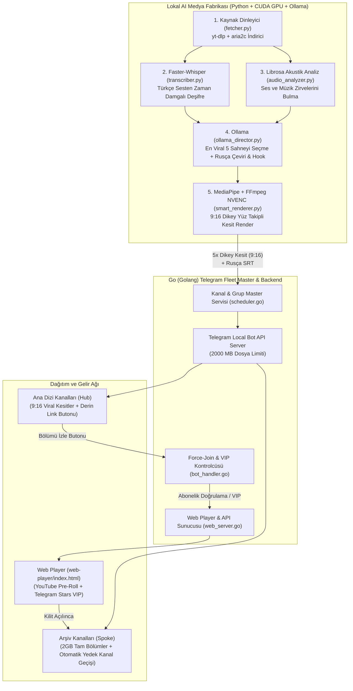

# TeleFleet & AutoClip AI (`master_of_turkish_series_channels`)

**Dış API Maliyeti Sıfır (Zero-API Cost) Lokal Yapay Zeka Kesit Fabrikası ve Çoklu Telegram Kanal Filosu Yönetim Sistemi**

Bu proje; yerel GPU donanımı üzerinde çalışan **Faster-Whisper (CUDA)**, **Librosa Akustik Analiz**, **Ollama (Qwen2.5 / Llama3.1)**, **MediaPipe Yüz Takibi** ve **FFmpeg NVENC** boru hattıyla video içeriklerini otomatik olarak işleyen, en dramatik/viral sahneleri tespit edip **9:16 dikey kesitlere** dönüştüren, Rusça altyazı ve başlık (hook) gömen ve **Go (Golang)** tabanlı merkezi orkestratör ile çoklu Telegram kanal filosunu yöneten uçtan uca otonom medya altyapısıdır.

---

## İçindekiler

1. [Sistemin Çalışma Felsefesi](#1-sistemin-çalışma-felsefesi)
2. [Proje Dizin Yapısı](#2-proje-dizin-yapısı)
3. [Uçtan Uca Sistem Mimarisi ve Akış Şemaları](#3-uçtan-uca-sistem-mimarisi-ve-akış-şemaları)
   - [3.1. Lokal AI Video Kesit ve Tam Bölüm Boru Hattı](#31-lokal-ai-video-kesit-ve-tam-bölüm-boru-hattı)
   - [3.2. Çoklu Kanal Master'ı (Hub & Spoke Mimarisi)](#32-çoklu-kanal-masterı-hub--spoke-mimarisi)
4. [Modül Detayları](#4-modül-detayları)
   - [4.1. Python Lokal AI Kesit ve Çeviri Motoru (`worker-python/`)](#41-python-lokal-ai-kesit-ve-çeviri-motoru-worker-python)
   - [4.2. Go Telegram Fleet Master & Backend (`master-go/`)](#42-go-telegram-fleet-master--backend-master-go)
   - [4.3. Web Player & Telegram Stars VIP Entegrasyonu (`web-player/`)](#43-web-player--telegram-stars-vip-entegrasyonu-web-player)
5. [Veritabanı Şeması (PostgreSQL)](#5-veritabanı-şeması-postgresql)
6. [Kurulum ve Çalıştırma Kılavuzu](#6-kurulum-ve-çalıştırma-kılavuzu)
   - [6.1. Gereksinimler](#61-gereksinimler)
   - [6.2. Ortam Değişkenleri (`.env`)](#62-ortam-değişkenleri-env)
   - [6.3. Docker Compose ile Tek Komutta Başlatma](#63-docker-compose-ile-tek-komutta-başlatma)
   - [6.4. Yeni Dizi / Kanal Ekleme Örneği (SQL)](#64-yeni-dizi--kanal-ekleme-örneği-sql)

---

## 1. Sistemin Çalışma Felsefesi

1. **Dış API'lere Sıfır Bağımlılık (Zero-API Cost):**
   Saatlerce süren video bölümlerini işlerken ücretli bulut API'leri (OpenAI, Claude, DeepL vb.) kullanmak yerine; ses tanıma (`faster-whisper`), akustik enerji/duygu analizi (`librosa`), sahne seçimi ve Rusça çeviri (`Ollama`), aktif yüz takipli dikey kadrajlama (`MediaPipe` + `OpenCV`) ve video birleştirme (`FFmpeg h264_nvenc`) işlemleri tamamen yerel GPU üzerinde sıfır API maliyetiyle çalışır.
2. **Çoklu Kanal Filosu Yönetimi (Multi-Series Fleet):**
   Sistem tek bir kanala bağlı kalmaz; birden fazla diziyi eşzamanlı takip eder. Her dizinin bir **Vitrin Kanalı (Hub)**, bir **Arşiv/Tam Bölüm Kanalı (Spoke)** ve yedek kanal (`backup_spoke_channel_id`) yapılandırması bulunur.
3. **2 GB Dosya Limiti Desteği (`Telegram Local Bot API`):**
   Standart Telegram Bot API'nin 50 MB yükleme sınırı, Docker Compose içindeki resmi `aiogram/telegram-bot-api` (`TELEGRAM_LOCAL=1`) sunucusu ile 2.000 MB (2 GB) seviyesine çıkarılmıştır.

> **Güvenlik ve Uyumluluk Notu:** Bu depodaki uygulama; görünmez katmanlarla kullanıcı tıklamasını çalan (clickjacking / UI redressing), aldatıcı pop-under açan veya üçüncü taraf kanallara spam yorum atan bileşenleri içermez. Gelir modeli; şeffaf sponsorlu Pre-Roll video oynatıcı (`YouTube IFrame API`), zorunlu kanal aboneliği doğrulaması (`Force-Join Gatekeeper`) ve **Telegram Stars (`XTR`)** ile reklamsız VIP abonelik satışı üzerine kuruludur.

---

## 2. Proje Dizin Yapısı

```text
master_of_turkish_series_channels/
├── .env.example                  # Örnek ortam değişkenleri şablonu
├── .gitignore                    # Git hariç tutma kuralları
├── docker-compose.yml            # PostgreSQL, Redis, Local Bot API, Ollama, Python Worker ve Go Master
├── README.md                     # Mimari doküman ve kurulum kılavuzu
├── migrations/
│   └── 001_init.sql              # PostgreSQL veritabanı tabloları ve indeksleri
├── worker-python/                # Lokal AI Video Kesit ve Çeviri Motoru
│   ├── Dockerfile                # CUDA 12.2 + FFmpeg + Aria2 + Python imajı
│   ├── requirements.txt          # Python bağımlılıkları
│   ├── config.py                 # Ortam değişkenleri ve worker ayarları
│   ├── db.py                     # PostgreSQL veri erişim katmanı
│   ├── fetcher.py                # yt-dlp + aria2c ile kaynak tarama ve video indirme
│   ├── audio_analyzer.py         # Librosa ile akustik kaos ve ses zirvesi analizi
│   ├── transcriber.py            # Faster-Whisper (CUDA float16 / CPU int8) Türkçe deşifre
│   ├── ollama_director.py        # Yerel Ollama ile viral sahne seçimi ve Rusça çeviri
│   ├── smart_renderer.py         # MediaPipe EMA yüz takibi + 9:16 FFmpeg NVENC render
│   └── main.py                   # Uçtan uca AI boru hattı orkestratörü
├── master-go/                    # Go Çoklu Kanal Master'ı & Web Sunucusu
│   ├── Dockerfile                # Multi-stage Go 1.22 derleme ve çalışma imajı
│   ├── go.mod                    # Go modül tanımı
│   ├── config.go                 # Go servis yapılandırması
│   ├── db.go                     # PostgreSQL sorguları ve filo yönetimi
│   ├── bot_handler.go            # Telegram Bot, Force-Join kontrolü ve Telegram Stars (XTR) VIP
│   ├── scheduler.go              # Kesit paylaşımı, Spoke failover ve Cross-Promo zamanlayıcısı
│   ├── web_server.go             # Web Player API ve medya yayın uç noktaları
│   └── main.go                   # Go ana uygulama girişi
└── web-player/
    └── index.html                # YouTube Pre-Roll Content Locker + Telegram Stars VIP Web Player
```

---

## 3. Uçtan Uca Sistem Mimarisi ve Akış Şemaları

### 3.1. Lokal AI Video Kesit ve Tam Bölüm Boru Hattı



### 3.2. Çoklu Kanal Master'ı (Hub & Spoke Mimarisi)

```mermaid
sequenceDiagram
    autonumber
    actor Viewer as İzleyici
    participant Hub as Ana Dizi Kanalı (Hub)
    participant Bot as Go Fleet Master Bot
    participant Web as Web Player (Pre-Roll & VIP)
    participant Spoke as Arşiv Kanalı (Spoke)

    Hub->>Viewer: Lokal AI'ın ürettiği 45-60 sn'lik Rusça altyazılı 9:16 kesit düşer
    Viewer->>Hub: Altındaki "▶️ Смотреть полную серию" butonuna tıklar
    Hub->>Bot: t.me/TurDiziMasterBot?start=ep_yalicapkini_65
    Bot->>Viewer: Zorunlu kanallara abonelik kontrolü (getChatMember - Force-Join)
    Viewer->>Bot: Kanallara abone olur ve "✅ Я подписался" butonuna basar
    Bot->>Viewer: Abonelik doğrulanır; Ücretsiz Web Player veya Telegram Stars VIP (50 XTR) sunulur
    Viewer->>Web: Web Player'da "Oynat" butonuna basar
    Web->>Viewer: 30 sn Sponsorlu YouTube Pre-Roll oynatılır (sekme gizlenirse sayaç durur)
    Web->>Viewer: Sayaç bitince tam bölüm oynatıcısı ve Spoke arşiv kanalı linki açılır
```

---

## 4. Modül Detayları

### 4.1. Python Lokal AI Kesit ve Çeviri Motoru (`worker-python/`)

* **[fetcher.py](file:///c:/Users/ahmet/Desktop/Projects/master_of_turkish_series_channels/worker-python/fetcher.py):** `series_fleet` tablosundaki aktif kaynakları `yt-dlp --flat-playlist` ile tarar, bölüm numarasını regex ile ayrıştırır ve yeni bölümleri `aria2c` çoklu iş parçacığı desteğiyle `1080p MP4` olarak indirir.
* **[audio_analyzer.py](file:///c:/Users/ahmet/Desktop/Projects/master_of_turkish_series_channels/worker-python/audio_analyzer.py):** Videonun ses izini geçici `16kHz mono WAV` olarak çıkarır; `librosa` ile kısa süreli RMS enerjisi ve `onset_strength` (spektral akı) hesaplayarak duygusal patlama yaşanan en yüksek enerjili 15 zaman penceresini (45 sn) belirler.
* **[transcriber.py](file:///c:/Users/ahmet/Desktop/Projects/master_of_turkish_series_channels/worker-python/transcriber.py):** `faster-whisper` kullanarak Türkçe konuşmaları kelime bazlı zaman damgalarıyla (`word_timestamps=True`, `vad_filter=True`) metne döker. CUDA mevcut değilse otomatik olarak CPU `int8` moduna geçer.
* **[ollama_director.py](file:///c:/Users/ahmet/Desktop/Projects/master_of_turkish_series_channels/worker-python/ollama_director.py):** Akustik zirve pencereleri ile Türkçe diyalogları birleştirip yerel Ollama (`qwen2.5:14b` veya `llama3.1:8b`) modeline gönderir. En yüksek merak uyandıran 5 kesiti JSON formatında (`start_sec`, `end_sec`, `viral_score`, `hook_title_ru`, `caption_ru`, `subtitles_ru`) seçer ve tam bölümün SRT çevirisini üretir.
* **[smart_renderer.py](file:///c:/Users/ahmet/Desktop/Projects/master_of_turkish_series_channels/worker-python/smart_renderer.py):** `MediaPipe Face Detection` ile her 0.4 saniyede bir aktif oyuncunun yüz merkezini tespit eder, **Üstel Hareketli Ortalama (EMA)** ile kamera kaymasını yumuşatır ve `FFmpeg` (`h264_nvenc`, başarısız olursa `libx264` fallback) ile `1080x1920` (9:16) dikey videoyu, üst Rusça Hook bandını, sarı/beyaz Rusça altyazıyı ve kanal filigranını render eder.

### 4.2. Go Telegram Fleet Master & Backend (`master-go/`)

* **[bot_handler.py / bot_handler.go](file:///c:/Users/ahmet/Desktop/Projects/master_of_turkish_series_channels/master-go/bot_handler.go):**
  * **Force-Join Gatekeeper:** Kullanıcının `REQUIRED_CHANNELS` listesindeki kanallara üye olup olmadığını `getChatMember` ile denetler.
  * **Telegram Stars (`XTR`) VIP Ödeme:** `sendInvoice` (`currency: "XTR"`), `answerPreCheckoutQuery` ve `successful_payment` akışlarını işleyerek kullanıcıya anında 30 günlük reklamsız VIP erişim tanımlar.
* **[scheduler.go](file:///c:/Users/ahmet/Desktop/Projects/master_of_turkish_series_channels/master-go/scheduler.go):**
  * **Zamanlanmış Kesit Paylaşımı:** `ai_viral_clips` tablosunda zamanı gelen kesitleri `file://` protokolüyle Local Bot API üzerinden ilgili Hub kanalına gönderir.
  * **Otomatik Yedek Kanal Geçişi (`SpokeFailover`):** Aktif Spoke kanalının sağlık durumunu `getChat` ile denetler; kanal erişilemezse `backup_spoke_channel_id` kanalını devreye sokup `createChatInviteLink` ile tüm davet linklerini günceller.
  * **Çapraz Trafik Matrisi (`Cross-Promo`):** Her akşam Hub kanalları arasında en yüksek viral skorlu kesitleri birbirine `forwardMessage` ile iletir ve 6 saat sonra `deleteMessage` ile otomatik temizler.
* **[web_server.go](file:///c:/Users/ahmet/Desktop/Projects/master_of_turkish_series_channels/master-go/web_server.go):** `/watch`, `/api/player-config`, `/api/ad-complete` ve `/health` uç noktalarını sunar.

### 4.3. Web Player & Telegram Stars VIP Entegrasyonu (`web-player/`)

* **[index.html](file:///c:/Users/ahmet/Desktop/Projects/master_of_turkish_series_channels/web-player/index.html):**
  * Resmi `YouTube IFrame API` üzerinden sponsorlu Pre-Roll videosunu oynatır.
  * Kullanıcı videoyu durdurursa (`YT.PlayerState.PLAYING` dışı) veya tarayıcı sekmesini gizlerse (`document.hidden`) geri sayım sayacını duraklatır.
  * Süre tamamlandığında `/api/ad-complete` çağrısı yaparak asıl bölüm oynatıcısını ve Telegram Spoke arşiv kanalı bağlantısını açar.
  * VIP kullanıcılar için (`is_vip: true`) bekleme süresini tamamen atlar.

---

## 5. Veritabanı Şeması (PostgreSQL)

Tüm şema [migrations/001_init.sql](file:///c:/Users/ahmet/Desktop/Projects/master_of_turkish_series_channels/migrations/001_init.sql) dosyasında tanımlanmıştır:

| Tablo Adı | Açıklama |
| :--- | :--- |
| `series_fleet` | Takip edilen diziler, kaynak URL'leri, Hub ve Spoke kanal ID'leri, yedek Spoke kanal ID'si. |
| `episodes` | Tespit edilen bölümler, işleme durumları (`detected` -> `downloading` -> `transcribing` -> `clipping` -> `uploading` -> `published`), dosya yolları. |
| `ai_viral_clips` | Lokal AI tarafından üretilen 9:16 dikey kesitler, zaman aralıkları, Rusça Hook başlıkları ve paylaşım zamanlaması. |
| `monetization_targets` | Web Player'da gösterilecek YouTube Pre-Roll ve sponsor kampanyaları, ağırlık puanları ve gösterim/tamamlama sayaçları. |
| `telegram_users` | Botu kullanan izleyiciler, VIP abonelik durumları (`is_vip`, `vip_expires_at`) ve izlenen reklam sayıları. |
| `cross_promo_logs` | Kanallar arası forward edilen mesajların 6 saat sonra otomatik silinmesi için tutulan kayıtlar. |

---

## 6. Kurulum ve Çalıştırma Kılavuzu

### 6.1. Gereksinimler

* **Docker** ve **Docker Compose v2+**
* **NVIDIA GPU** + **NVIDIA Container Toolkit** (Lokal Whisper ve Ollama GPU hızlandırması için önerilir; GPU yoksa sistem otomatik olarak CPU fallback modunda çalışır)
* Telegram Bot Token (`@BotFather`) ve Telegram API ID / Hash (`my.telegram.org`)

### 6.2. Ortam Değişkenleri (`.env`)

Örnek yapılandırma dosyasını kopyalayın ve kendi bilgilerinizle düzenleyin:

```bash
cp .env.example .env
```

### 6.3. Docker Compose ile Tek Komutta Başlatma

1. Tüm servisleri derleyip arka planda başlatın:

```bash
docker compose up -d --build
```

2. Ollama konteynerine kullanacağınız lokal LLM modelini indirin (tek seferlik):

```bash
docker exec -it telefleet-ollama ollama pull qwen2.5:14b
```

3. Servis durumlarını ve logları kontrol edin:

```bash
docker compose ps
docker compose logs -f autoclip-worker fleet-master-go
```

### 6.4. Yeni Dizi / Kanal Ekleme Örneği (SQL)

Sisteme yeni bir dizi ve kanal çifti eklemek için PostgreSQL veritabanına aşağıdaki gibi bir kayıt ekleyebilirsiniz:

```sql
INSERT INTO series_fleet (
    slug,
    title_tr,
    title_ru,
    source_url,
    hub_channel_id,
    hub_channel_username,
    active_spoke_channel_id,
    active_spoke_invite_link,
    backup_spoke_channel_id
) VALUES (
    'yalicapkini',
    'Yalı Çapkını',
    'Зимородок',
    'https://www.youtube.com/@YaliCapkiniDizi/videos',
    -1001111111111,
    '@Zimorodok_RU_Hub',
    -1002222222222,
    'https://t.me/+AbCdEfGhIjKlMnOp',
    -1003333333333
);
```
